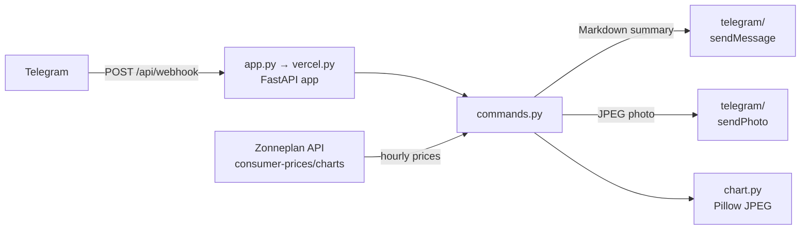

# ⚡ zonneplan-telegram

Fetches the hourly electricity prices from the [Zonneplan](https://www.zonneplan.nl) consumer API, serves them on demand through a Telegram bot and archives the price history as one JSON file per day.

The bot is deployed as a [Vercel Function](https://vercel.com/docs/functions) that receives Telegram updates through a webhook, so commands are answered immediately instead of being pushed by a scheduled workflow. Messages are in English and prices are reported in `ct/kWh`, the unit used by the Zonneplan app.

## Commands

| Command | Reply |
| --- | --- |
| `/priceNow` | Tariff of the current hour, plus today's min / max / average |
| `/priceTomorrow` | Tomorrow's min / max / average with the hours of the cheapest and most expensive slot, or a notice while the prices are not published yet |
| `/chart` | The Zonneplan bar chart for today (00:00–23:59), sent as a JPEG photo |
| `/digest` | Preview of the daily digest (today's minimum and the cheapest 5-hour window) |
| `/subscribe` | Subscribe the chat to the daily digest |
| `/unsubscribe` | Unsubscribe the chat from the daily digest |
| `/help` (and `/start`) | The list of commands |

Matching is case-insensitive and tolerates the `@botusername` suffix, so `/priceNow`, `/pricenow` and `/priceNow@MyBot` all work. Any chat may use the bot.

## Daily digest

A subscriber receives one message per day at **06:00 Europe/Amsterdam** with the day's outlook:

```
⚡ **Zonneplan - Daily digest** ⚡

📅 **Today (2026-10-13)**
💡 Minimum: `26.20 ct/kWh` at `14:00`
🏆 Cheapest 5h window: `11:00 - 16:00` (`avg 27.60 ct/kWh`)
```

- The cheapest window is the five **consecutive** hours (DST-safe: it works on the ordered hour list) with the lowest average price; ties resolve to the earliest window.
- `/subscribe` and `/unsubscribe` maintain the subscriber set, which is stored in Upstash Redis (see [Configuration](#configuration)). `/digest` renders the message on demand without touching the store.
- Delivery is triggered from **outside** the app: an external scheduler calls `GET /api/digest` with the `X-Digest-Secret` header. Schedule it **hourly** — the endpoint only sends when the local hour in `Europe/Amsterdam` matches `DIGEST_HOUR` (default `6`), so the summer/winter clock change is handled in code and the scheduler needs no timezone support.
- `GET /api/digest?force=1` (with a valid secret) bypasses the hour guard to test delivery. `GET /api/digest` returns `{"ok": true, "skipped": true, "sent": 0}` outside the digest hour.
- When nobody is subscribed the endpoint stays silent and returns `{"ok": true, "skipped": false, "sent": 0}`.

## Usage analytics

Every command the webhook answers is recorded, so the bot's adoption can be charted without adding any infrastructure: the aggregates live in the same Upstash Redis database that already stores the digest subscribers.

| Recorded | Where |
| --- | --- |
| Raw events (timestamp, chat, user, command, success) | `zonneplan-telegram:analytics:events`, a stream capped at 10 000 entries |
| Commands, failures and digest deliveries per day and per hour | `zonneplan-telegram:analytics:daily:<YYYY-MM>` |
| All-time counters, including one per command | `zonneplan-telegram:analytics:totals` |
| Unique users per day / week / month / all time | `zonneplan-telegram:analytics:users:day|week|month|all` |
| Per-user profile (username, first/last seen) and ranking | `zonneplan-telegram:analytics:user:<id>`, `…:user-commands` |

Days and hours are bucketed in `Europe/Amsterdam`, like the digest, so the numbers do not shift when Vercel runs on UTC. Slash commands the bot does not implement are counted in an `unknown` bucket; plain text messages are ignored.

Recording is best effort: when the Upstash credentials are missing or Redis is unreachable, a warning is logged and the bot still replies. Note that **the raw Telegram user id and username are stored, so this is personal data** — treat the Redis database and the analytics endpoint accordingly.

### The dashboard endpoint

`GET /api/analytics` returns the aggregates as JSON for a dashboard:

```json
{
  "generated_at": "2026-10-15T09:31:00+00:00",
  "totals": { "users": 12, "commands": 438, "errors": 1, "digest_sent": 96 },
  "daily": [{ "date": "2026-10-15", "time": "2026-10-15T00:00:00Z", "commands": 18, "errors": 0, "digest_sent": 3, "users": 4 }],
  "weekly": [{ "week": "2026-W42", "time": "2026-10-12T00:00:00Z", "users": 9 }],
  "monthly": [{ "month": "2026-10", "time": "2026-10-01T00:00:00Z", "users": 12 }],
  "commands": [{ "command": "/pricenow", "count": 180 }],
  "hourly": [{ "hour": 7, "count": 42 }],
  "digest": [{ "date": "2026-10-15", "time": "2026-10-15T00:00:00Z", "sent": 3 }],
  "users": [{ "user_id": 1234567, "username": "someone", "commands": 42, "first_seen": "2026-09-28T06:12:00+00:00", "last_seen": "2026-10-15T09:02:00+00:00" }]
}
```

- The payload is cached in Redis for 60 seconds, so a dashboard may refresh often without draining the Upstash command quota.
- It answers `503` while `ANALYTICS_SECRET` is unset and `401` when the secret does not match. Send it as `X-Analytics-Secret: <secret>` or as `Authorization: Bearer <secret>`.

### Grafana dashboard

The dashboard is [Grafana](https://grafana.com/oss/grafana/) (AGPL) with the [Infinity data source](https://github.com/grafana/grafana-infinity-datasource) (FOSS) reading the JSON endpoint. Everything ships in `deploy/grafana/` and needs no other service:

```bash
cd deploy/grafana
cp .env.example .env      # set ANALYTICS_SECRET to the Vercel value
docker compose up -d
# http://localhost:3000 → "Zonneplan Telegram" → "Zonneplan Telegram Bot"
```

The compose file starts Grafana with the Infinity plugin pre-installed, provisions the data source from `provisioning/` (base URL, allowed host and the `X-Analytics-Secret` header all come from the container environment) and loads `dashboards/zonneplan-telegram.json`. The dashboard shows unique users per day / week / month, the command breakdown, peak hours, failures, digest deliveries and the top users, and refreshes hourly. Panels can be edited in the UI — the file is re-read every 30 seconds, and `allowUiUpdates` is on, so changes persist.

## How it works



Two entrypoints share the same building blocks.

**`app.py` → `vercel.py` — the webhook (`POST /api/webhook`)**

1. **Verify** — the `X-Telegram-Bot-Api-Secret-Token` header is compared with `TELEGRAM_WEBHOOK_SECRET`; updates that fail the check are dropped.
2. **Dispatch** — `commands.py` maps the command to a handler that fetches the prices and replies in the chat that asked.
3. **Record** — the answered command is folded into the Upstash analytics aggregates (see [Usage analytics](#usage-analytics)). A failure there is logged and swallowed.

**`vercel.py` — the digest trigger (`GET|POST /api/digest`)**

1. **Verify** — the `X-Digest-Secret` header must match `DIGEST_SECRET`.
2. **Guard** — sends only when the local hour matches `DIGEST_HOUR`; `digest.py` then fans the rendered message out to the subscribed chats.

**`cli.py` — the scheduled archiver (`update_prices()`)**

1. **Fetch** — `get_zonneplan_hourly_prices()` calls `GET /api/consumer-prices/charts/electricity-hourly` and parses the payload into `APIResponse`.
2. **Archive** — `PriceStorage.save_prices()` groups the prices by local date and writes/updates `data/YYYY-MM-DD.json`.

## Requirements

- Python >= 3.12 (CI runs 3.14)
- [uv](https://docs.astral.sh/uv/) for dependency management and execution
- A Telegram bot token

## Installation

```bash
git clone https://github.com/Crissal1995/zonneplan-telegram.git
cd zonneplan-telegram
uv sync
```

## Configuration

The credentials are read from the environment at runtime:

| Variable | Required | Description |
| --- | --- | --- |
| `TELEGRAM_BOT_TOKEN` | yes | Bot token issued by [@BotFather](https://t.me/BotFather) |
| `TELEGRAM_WEBHOOK_SECRET` | recommended | Secret that Telegram echoes back in the `X-Telegram-Bot-Api-Secret-Token` header. When unset, every caller is accepted |
| `UPSTASH_REDIS_REST_URL` | for the digest | Upstash Redis REST endpoint that stores the digest subscribers |
| `UPSTASH_REDIS_REST_TOKEN` | for the digest | Upstash Redis REST token paired with the URL |
| `DIGEST_SECRET` | for the digest | Shared secret the scheduler sends back in the `X-Digest-Secret` header. The `/api/digest` trigger answers `503` while it is unset |
| `DIGEST_HOUR` | no | Local hour (`Europe/Amsterdam`) the digest is delivered at. Defaults to `6` |
| `ANALYTICS_SECRET` | for the dashboard | Shared secret the Grafana data source sends in `X-Analytics-Secret`. `/api/analytics` answers `503` while it is unset |

The Upstash variables are needed by the daily digest and by the analytics store; `DIGEST_SECRET` and `ANALYTICS_SECRET` only guard their respective endpoints.

For local development, create a `.env` file in the repository root — it is loaded automatically when `python-dotenv` is installed (it is part of the `dev` dependency group):

```dotenv
TELEGRAM_BOT_TOKEN=123456:ABC-DEF...
TELEGRAM_WEBHOOK_SECRET=some-random-string
UPSTASH_REDIS_REST_URL=https://xxx.upstash.io
UPSTASH_REDIS_REST_TOKEN=your-upstash-rest-token
DIGEST_SECRET=some-other-random-string
ANALYTICS_SECRET=yet-another-random-string
```

Both `send_telegram_message()` and `send_telegram_photo()` take an explicit `chat_id`; their `bot_token` argument takes precedence over the environment.

## Deploying to Vercel

The repository needs no build step: Vercel detects the FastAPI app from the `fastapi` dependency in `pyproject.toml`, and `[tool.vercel] entrypoint = "app:app"` points at the root-level `app.py`, which re-exports the FastAPI instance from the `src` layout (Vercel resolves that setting as a path relative to the project root, so it cannot reference `src/zonneplan_telegram/vercel.py` directly). Steps that have to be done once, outside the repository:

1. **Import the project.** In the [Vercel dashboard](https://vercel.com/new), import the GitHub repository. Leave *Root Directory* at the repository root and keep the detected **FastAPI** framework preset.
2. **Add environment variables.** In *Project Settings → Environment Variables*, add `TELEGRAM_BOT_TOKEN` and `TELEGRAM_WEBHOOK_SECRET` for the Production (and optionally Preview) environment, plus `UPSTASH_REDIS_REST_URL`, `UPSTASH_REDIS_REST_TOKEN`, `DIGEST_SECRET` and `ANALYTICS_SECRET` for the digest and the analytics endpoint.
3. **Deploy** and note the production URL, e.g. `https://zonneplan-telegram.vercel.app`.
4. **Register the webhook** from a local checkout, once per deployment URL:

   ```bash
   uv run set-webhook https://zonneplan-telegram.vercel.app
   ```

   This calls `setWebhook` (with `secret_token` when `TELEGRAM_WEBHOOK_SECRET` is set) and `setMyCommands`, so the commands also appear in the Telegram menu.
5. **Verify** the registration:

   ```bash
   uv run set-webhook --info          # current webhook status
   uv run set-webhook --delete        # remove it again
   ```

`vercel.json` pins the function to a single European region, allows up to 30 seconds for chart rendering and keeps `data/`, `.github/` and the Markdown files out of the bundle.

### What still runs on GitHub Actions

The Vercel filesystem is read-only apart from `/tmp`, so the webhook never writes to `data/`. The scheduled `push.yaml` workflow keeps archiving the price history and committing it back to the repository, while Vercel only serves the on-demand commands.

## Usage

The on-demand Telegram commands are served by the deployed Vercel Function, so register its webhook first (see [Deploying to Vercel](#deploying-to-vercel)). To reproduce what the scheduled workflow does — fetch the prices and archive them to `data/` — run the CLI locally from the repository root:

```bash
uv run update-prices
```

The console script maps to `zonneplan_telegram.cli:update_prices` (see `[project.scripts]` in `pyproject.toml`). Equivalent invocations:

```bash
uv run python -m zonneplan_telegram.cli
uv run -m zonneplan_telegram.cli   # uv's --module flag
```

Run `uv run -m zonneplan_telegram` (without `.cli`) only imports the package: the package has no `__main__.py`.

In CI the run is pinned and dev dependencies are excluded:

```bash
UV_FROZEN=1 UV_NO_DEV=1 uv run update-prices
```

## Data storage

Price history is written to `data/`, relative to the current working directory, with one file per **local** day:

```json
{
  "2026-09-29T00:00:00+00:00": {
    "start_date": "2026-09-29T00:00:00+00:00",
    "end_date": "2026-09-29T01:00:00+00:00",
    "amount": 3360943.0
  }
}
```

- Keys are the UTC ISO-8601 start timestamps; the filename uses the local date.
- `amount` is the raw API value. `Price.price_eur` converts it with a `1e-7` factor and `Price.price_cents` with `1e-5`, so the example above is `33.61 ct/kWh`.
- An existing day file is only rewritten when the newly fetched data contains **more entries** than the stored file, so already-recorded hours are not overwritten.
- A missing file (or one that fails to parse) is treated as an empty history and reported through `loguru`; the run continues.

## Development

The quality gates are the same ones CI runs, in the same order:

```bash
uv run ruff format --check   # formatting
uv run ruff check            # linting
uv run ty check              # typing
uv run pytest                # test suite
```

`uv run ruff format` and `uv run ruff check --fix` apply the fixes.

Ruff is configured with `line-length = 120` and `select = ["ALL"]`, ignoring copyright rules (`CPY`), the comma rule that conflicts with the formatter (`COM812`) and docstring rules (`D`); the suite additionally ignores `S101` (`assert`) and `PLR2004`.

### Tests

`tests/` runs **offline**: the Upstash transport is faked and the route functions are called directly, so no credentials and no Redis are involved. `uv run pytest` covers the Redis client (pipeline request shape, error replies, missing credentials), the analytics aggregates (the exact write commands, failure counting, the rendered dashboard payload) and the HTTP layer (command dispatch, recording, and the `503` / `401` / `200` behaviour of `/api/analytics`).

### Trying the dashboard locally

Grafana shows "No data" until the app actually answers `/api/analytics`, which means the code has to be deployed (or served locally) and at least one command has to have been recorded — there is no backfill from the archived price history. To exercise the whole chain without touching production:

1. Point `.env` at a **scratch** Upstash database: the local webhook writes real events.
2. Serve the app on the host (the `--with uvicorn` flag installs it for that run only):

   ```bash
   uv run --with uvicorn uvicorn zonneplan_telegram.vercel:app --port 8000
   ```

3. In `deploy/grafana/.env` set `ANALYTICS_BASE_URL=http://host.docker.internal:8000` and an `ANALYTICS_SECRET` that matches, then `docker compose up -d && docker compose restart grafana` (the provisioning is only re-read on start).
4. Generate events by POSTing synthetic updates — no Telegram needed:

   ```bash
   curl -X POST http://localhost:8000/api/webhook -H "Content-Type: application/json" \
     -d '{"update_id":1,"message":{"chat":{"id":1},"text":"/help","from":{"id":1,"username":"tester"}}}'
   ```

5. Reload the dashboard. Add a matching `ANALYTICS_SECRET` to the local environment so the guard accepts the request.

`host.docker.internal` resolves to the host from inside the container on Windows and macOS. On Linux, add `extra_hosts: ["host.docker.internal:host-gateway"]` to the `grafana` service.

A Vercel **preview** deployment can be used the same way, but preview URLs sit behind Vercel Authentication by default and answer `401 Protected deployment` to Grafana — either turn *Deployment Protection* off for previews or send the `x-vercel-protection-bypass` bypass header from the data source.

### Continuous integration

| Workflow | Trigger | What it does |
| --- | --- | --- |
| `qualify.yaml` | `pull_request` | Runs `ruff format --diff`, `ruff check`, `ty check` and `pytest` |
| `push.yaml` | `workflow_dispatch` | Runs `update-prices`, then commits the new data through an auto-merged pull request |

`push.yaml` needs the `PAT` secret (a token with `repo` scope; the job already declares `contents: write` and `pull-requests: write`). It runs `update-prices`, closes any still-open pull request on the `automated-data-update` branch, opens a fresh one with `peter-evans/create-pull-request`, approves and squash-merges it with `--admin`. The approval and merge steps are skipped when no data changed and therefore no pull request was created.

## Project structure

```
.
├── app.py                        # Vercel entrypoint: re-exports the FastAPI app
├── .github/workflows/
│   ├── qualify.yaml              # PR quality gate (tox)
│   └── push.yaml                 # run update-prices + auto-merge data updates
├── data/                         # archived price history (one JSON per day)
├── src/zonneplan_telegram/
│   ├── cli.py                    # scheduled CLI: fetch → archive
│   ├── vercel.py                 # FastAPI webhook application
│   ├── commands.py               # command handlers + Telegram menu metadata
│   ├── digest.py                 # daily digest rendering + subscriber fan-out
│   ├── subscriptions.py          # Upstash Redis subscriber store
│   ├── analytics.py              # Upstash usage analytics (recording + dashboard summary)
│   ├── upstash.py                # Upstash Redis REST client (commands + pipelines)
│   ├── chart.py                  # Pillow JPEG bar chart
│   ├── storage.py                # per-day JSON persistence
│   ├── api/
│   │   ├── __init__.py           # API base URL
│   │   └── hourly_prices/
│   │       ├── __init__.py       # HTTP calls (hourly & quarter-hourly)
│   │       └── model.py          # pydantic models + Markdown rendering
│   └── telegram/
│       ├── __init__.py           # sendMessage / sendPhoto clients
│       ├── models.py             # minimal Update / Message / Chat models
│       └── set_webhook.py        # `set-webhook` CLI (setWebhook + setMyCommands)
├── deploy/grafana/               # self-hosted Grafana: compose, provisioning, dashboard
├── tests/                        # pytest suite (offline: faked Upstash, direct route calls)
├── pyproject.toml                # metadata, deps, vercel entrypoint, ruff & pytest config
├── vercel.json                   # region, duration and bundle exclusions
└── uv.lock
```

## API endpoints

Base URL: `https://app-api.zonneplan.nl/api`

- `GET /consumer-prices/charts/electricity-hourly` — used by the bot
- `GET /consumer-prices/charts/electricity-quarter-hourly` — available via `get_zonneplan_quarter_hourly_prices()`

## Notes

- `data/` is resolved relative to the working directory, so run the `update-prices` CLI from the repository root.
- `chart.py` draws the chart with Pillow (no matplotlib nor numpy), so the JPEG stays cheap to produce on a cold start. Text uses Pillow's bundled default font, so no system font is required on the serverless host.
- `/chart` renders today's hours only: `handle_chart` passes `APIResponse.get_today_prices()`, so the x-axis spans 00:00–23:59 and tomorrow's published prices never appear. Hours are labelled, and bars are split into grey (elapsed) and green (current hour and upcoming), in `MARKET_TIMEZONE` (`Europe/Amsterdam`) rather than in the timezone of the machine that renders the chart, so the axis stays correct on a UTC server such as Vercel. Bar tops are rounded and the cheapest and the most expensive hour print their price above the bar.
- Telegram renders raster images inline through `sendPhoto`, so `/chart` delivers the JPEG with `sendPhoto` and it appears directly in the chat instead of as a downloadable file.
- `/chart` writes its JPEG to `/tmp`, the only writable location on Vercel.
